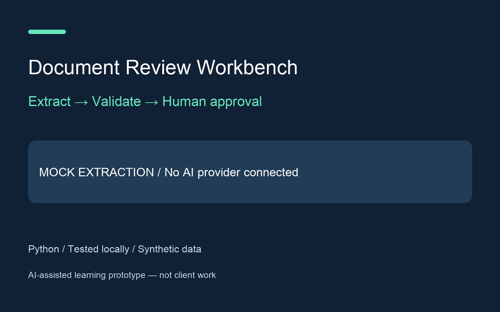

# Document Review Workbench — mock extraction development demo

Review a synthetic digital invoice, correct structured fields, validate arithmetic and export an approved CSV with source filename, page and SHA-256. AI-assisted learning project; no real financial or personal information.

**Extraction is deterministic MOCK rules, not AI. No model provider is connected. Live AI extraction accuracy and end-to-end integration are untested.** Do not publish this package as a working AI extraction case study.

## Install and run

Python 3.12 (verified 3.12.3/macOS):

```sh
python3 -m venv .venv
.venv/bin/python -m pip install -r requirements.txt
.venv/bin/python review.py examples/invoice-1.pdf --output reviewed.csv
.venv/bin/python -m unittest discover -v
```

The terminal displays source text and every proposed field. Enter a replacement or press Enter to keep the value. After validation, compare fields with the source and type `APPROVE` to export. Any other answer cancels. Output uses exclusive creation and refuses existing files/symlinks. Source PDF bytes are not written. After write failures a partial CSV may remain; there is no atomic/durable publication guarantee. Use a fresh output filename after inspecting partial output.

`examples/invoice-1.pdf` and `invoice-2.pdf` are generated digital fixtures with different labels. `examples/expected-invoice-1.csv` is an automated approval-path fixture, not a record of human financial review. Its matching transcript labels the test. `make_examples.py` regenerates PDFs with reportlab (development requirements).

## Validation and limitations

One invoice on one page within an unencrypted PDF of at most 2 pages / 2 MiB. Only the supplied English label layouts are parsed. Duplicate fields and fields split across pages are rejected. No OCR, scans, tables, line-item extraction, handwriting or arbitrary invoice support. Fields: invoice ID, ISO date, subtotal, tax, total, currency and source page. Amounts are nonnegative with exactly two decimals; subtotal plus tax must equal total. Supported currencies: USD, EUR, GBP. No tax/legal/accounting interpretation. A human can correct extracted values; the demo does not validate whether a correction is factually true. Source page is derived from extraction, not editable. No separate persistent correction history is kept.

Use only trusted synthetic PDFs. Size/page limits are not a malicious-PDF sandbox. All text is treated as data. `adapter_contract.py` defines the future extraction interface and JSON schema but provides no network implementation. Model refusals, uncertain fields and invalid schemas must be surfaced to a reviewer before export. Structured schema compliance alone does not establish correctness.

Future live acceptance needs an approved provider/model, secure provisioning, explicit permission for a bounded test call and separate accuracy/refusal tests. No credentials are included in this repository. Official structured-output reference: https://developers.openai.com/api/docs/guides/structured-outputs

`evidence/current-tests.txt` records actual tests, including both PDF files and the interactive approval/no-overwrite path. Preview PNGs are renders of the actual PDFs. `evidence/transcript.png` is a rendered test transcript, not a live provider UI screenshot.

## Repository status

Public learning portfolio project with synthetic fixtures. AI-assisted development. No private client data, live credentials or production state are included. No client outcomes or revenue claims. Tests are local checks, not proof of live service integration.
