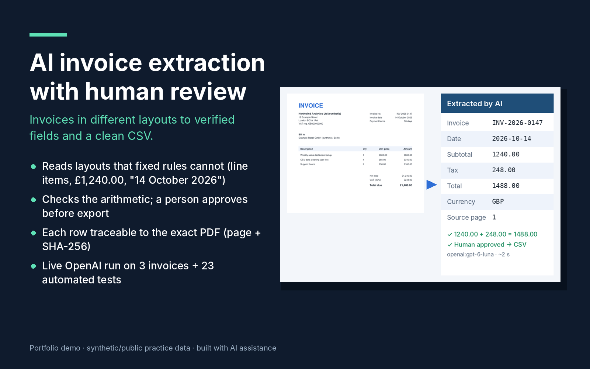
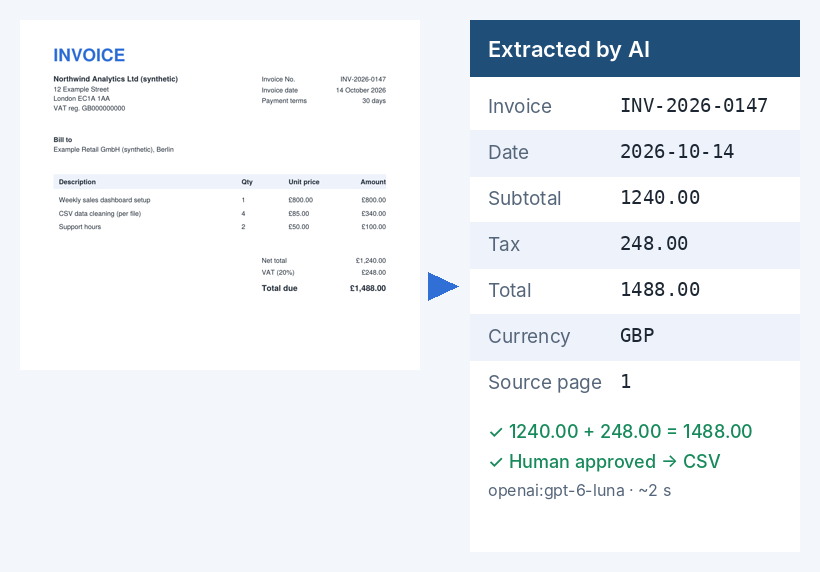

# AI invoice extraction with human review

Reads invoices in different layouts, pulls out the key fields with OpenAI, **checks the numbers**, lets a person confirm, and only then exports a clean CSV row that can be traced back to the exact PDF.



## What the live run showed

Real OpenAI API calls on three synthetic invoices ([evidence](evidence/live-openai-run.md)):

| Invoice | Layout | Fixed label rules | AI extraction |
|---|---|---|---|
| invoice-1 | `Invoice: DEMO-001` | ✓ | ✓ |
| invoice-2 | `Invoice number \| DEMO-002` | ✓ | ✓ |
| invoice-3 | realistic: line items, `£1,240.00`, "14 October 2026" | **✗ nothing found** | ✓ INV-2026-0147 · 2026-10-14 · 1240.00 + 248.00 = 1488.00 GBP |

About 2 seconds per invoice with `gpt-6-luna`; `gpt-5-mini` gave the same result.

## How it keeps the data trustworthy

1. **Strict output format:** the model must answer in a fixed JSON schema (OpenAI Structured Outputs). Anything else is rejected.
2. **Document text is treated as data:** instructions hidden inside a PDF are ignored.
3. **Validation:** dates, two-decimal amounts, currency codes, and `subtotal + tax = total`. If the AI is wrong, export is blocked.
4. **Human in the loop:** every field is shown for correction; nothing is saved until the reviewer types `APPROVE`.
5. **Traceability:** each CSV row records the source file, page, SHA-256 of the PDF and which model extracted it. Existing files are never overwritten.

## Run it

```sh
python3 -m venv .venv && .venv/bin/pip install -r requirements.txt
export OPENAI_API_KEY=...            # or OPENAI_API_KEY_FILE=/path/to/key
.venv/bin/python review.py examples/invoice-3.pdf --extractor openai --output reviewed.csv
.venv/bin/python -m unittest discover -v     # 23 tests, no network or key needed
```

Without a key, `--extractor mock` uses offline label rules (they read only the two simple layouts).

## Where this fits

Accounts-payable intake, expense reports, supplier statements: any flow where documents arrive in many formats and someone currently retypes the numbers. The same pattern (extract → validate → approve → export) works for receipts, purchase orders or delivery notes; a production setup would add OCR for scans and an accuracy test on real samples.

<details>
<summary>Technical details and limits (for developers)</summary>

### Original offline workflow

Python 3.12 (verified 3.12.3/macOS):

```sh
python3 -m venv .venv
.venv/bin/python -m pip install -r requirements.txt
.venv/bin/python review.py examples/invoice-1.pdf --output reviewed.csv
.venv/bin/python -m unittest discover -v
```

The terminal displays source text and every proposed field. Enter a replacement or press Enter to keep the value. After validation, compare fields with the source and type `APPROVE` to export. Any other answer cancels. Output uses exclusive creation and refuses existing files/symlinks. Source PDF bytes are not written. A single bounded read captures immutable bytes for both extraction and SHA-256, so later replacement of the path cannot mix fields and provenance. The hash identifies the captured bytes, not necessarily the current file at that path. Concurrent in-place writes during capture are unsupported; use stable synthetic inputs. CSV bytes are staged, flushed, fsynced and closed before an atomic no-clobber hard link publishes the destination. A write/fsync/link failure publishes no new destination; cleanup removes staging when possible. If staging cleanup fails after publication, the complete destination remains and the error explicitly reports its state. Inspect named files before retrying. This assumes trusted stable local directories and hard-link support; no power-loss durability or hostile-directory safety is claimed. Abrupt termination may leave a staging file, but does not expose it as the requested CSV destination.

`examples/invoice-1.pdf` and `invoice-2.pdf` are generated digital fixtures with different labels. `examples/expected-invoice-1.csv` is an automated approval-path fixture, not a record of human financial review. Its matching transcript labels the test. `make_examples.py` regenerates PDFs with reportlab (development requirements).

### Validation and limitations

One invoice on one page within an unencrypted PDF of at most 2 pages / 2 MiB. Only the supplied English label layouts are parsed. A document with no recognized fields is rejected before correction prompts, since its source page cannot be established. Duplicate fields and fields split across pages are rejected. No OCR, scans, tables, line-item extraction, handwriting or arbitrary invoice support. Fields: invoice ID, ISO date, subtotal, tax, total, currency and source page. Amounts are nonnegative with exactly two decimals; subtotal plus tax must equal total. Supported currencies: USD, EUR, GBP. No tax/legal/accounting interpretation. A human can correct extracted values; the demo does not validate whether a correction is factually true. Source page is derived from extraction, not editable. No separate persistent correction history is kept.

Use only trusted synthetic PDFs. Size/page limits are not a malicious-PDF sandbox. All text is treated as data. `adapter_contract.py` defines the extraction interface and JSON schema; `openai_provider.py` implements it with OpenAI Structured Outputs and rejects refusals, invalid JSON and schema drift. Model refusals, uncertain fields and invalid schemas must be surfaced to a reviewer before export. Structured schema compliance alone does not establish correctness.

The live integration was exercised on three synthetic PDFs (evidence/live-openai-run.md); a real-world accuracy and refusal test set is still future work. No credentials are included in this repository. Official structured-output reference: https://developers.openai.com/api/docs/guides/structured-outputs

`evidence/current-tests.txt` records actual tests, including both PDF files and the interactive approval/no-overwrite path. Preview PNGs are renders of the actual PDFs. `evidence/transcript.png` is a rendered test transcript, not a live provider UI screenshot.

</details>

---
Portfolio demo with synthetic documents, built with AI assistance. No real financial or personal data.
